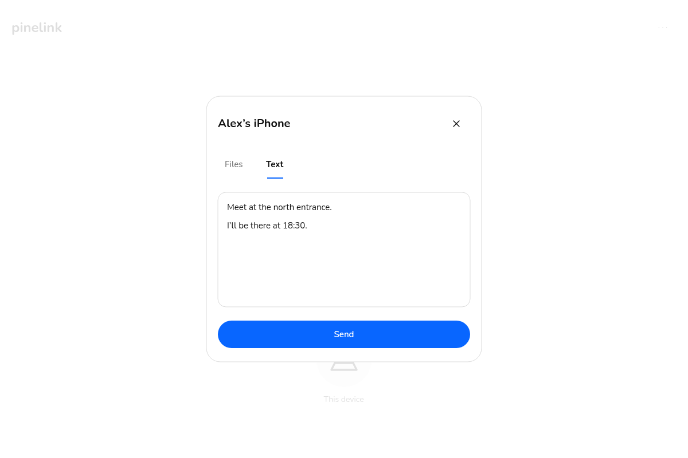
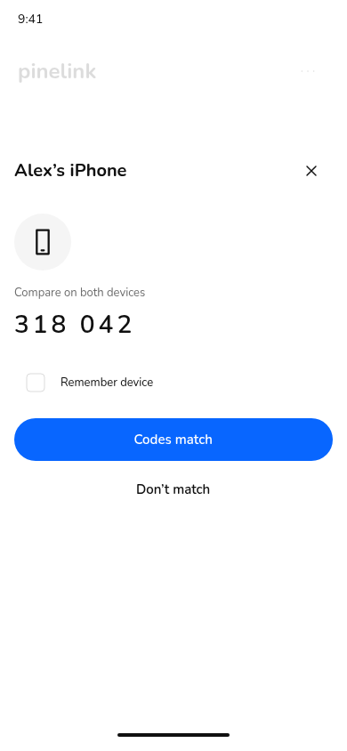

# Pinelink v28：跨用户握手与文本

**设计提案，待产品验收，尚未作为运行功能发布。** 对应 SIM-895。原生稿：[28-pinelink-peer-text.fig](../28-pinelink-peer-text.fig)。继承 v27 的 Google／账号密码两条独立登录路径；v27 也仍待具体设计验收。

这次增加两个能力：不同用户的明确设备可以建立连接、传文件；同账号和跨账号设备都可以发送纯文本。发现设备、建立信任、接收某次内容分别处理，不因知道设备名或记住设备就自动接收内容。

- **连接**：展示／扫描 QR 或粘贴邀请；对方确认。附近／手动连接比较两端短码。已有文件邀请时，可用一次 Receive 同时确认绑定密钥的连接和这次内容。
- **文本**：发送面板中切换 Files／Text；编写、接收、阅读和主动复制。支持复制失败后选择文本、离线待发送、超限与旧客户端回退。保留原文和换行，不自动打开链接或操作剪贴板。
- **记录**：文件和文本共用图标网格，用类型图标和小状态标记区分；标题仅用设备名。云副本过期后，本机已保存的文本仍可读取、复制。
- **主图与动效**：其他用户的设备加小人物标记，仍为两个节点、一条曲线。真实接收确认决定蓝灰边界，流光和暂停沿用已有规范；入场、退场和状态替换只跟随已确认状态。

## 画板

| 新页面 | 数量与内容 |
| --- | --- |
| 23 / Connect devices | 16：邀请、扫码、粘贴、双方确认、比较码、首次内容及连接后主图 |
| 24 / Handshake recovery | 8：到期、拒绝、相机不可用、短码不符、密钥变化、离线 |
| 25 / Text transfer | 23：文件／文本、编辑、接收、阅读、复制、离线、过期、兼容、320px、键盘、混合历史 |
| 26 / Peer and payload contract | 3：同意边界、内容与回执、动效与竞态 |

共 50 个新画板；原生文档保留前 23 个非空页面，共 27 个非空页面。画板名称与重新打开后的 ID 见 [manifest.json](manifest.json)。示例人物、短码和文件名均为设计数据；QR 编码的是 `pinelink-design-preview:peer-invitation-not-valid`，不是可用邀请。

## 复核与实现边界

在 OpenPencil 修改、保存、关闭并重开，检查新增四页的字体、父容器、同级覆盖及文本测量。Nunito 字体全部可用，无替代；父容器越界为 0。同级覆盖保留了面板覆盖暗淡背景、系统安全区和图标状态角标，逐类审核后未发现意外覆盖，不将原始覆盖数量说成 0。曲线已避开设备名下方的 24px 标签区，并保留 8px 间隔。

原生编辑期间曾发生内存越界，恢复后重新保存和检查。24 张 SVG 直接导出自最终原生图层；24 张 PNG 由 Fedora 隔离容器中的 Chromium 156 和仓库已采用的 Nunito 原文件生成，等待字体加载后截图，容器无网络。原生图层和文字保持可编辑；PNG 不作为替代设计源。证据见 [review-evidence.json](review-evidence.json) 和 [svg-preview-render.json](svg-preview-render.json)。

这些检查验证设计资产，不证明登录、握手、剪贴板或文件／文本运行功能已经完成。动画在契约画板中定义，目前没有可播放原型。实现约束、已有代码审计、依赖及后续 Fedora 验收见 [peer-text-contract.md](peer-text-contract.md)。本次不发布新应用版本或变更 staging／生产。

## 复现设计源

`node designs/28-peer-text/build-frames.mjs <output.json>` 生成每帧的 OpenPencil JSX。以 v27 原生文件为基础，在对应四页逐帧 render；对 `Intrinsic /` 文本启用原生宽高自适应。文件名和 tab 标签使用显式行高、自然测量宽度与单行固定容器，避免窄宽换行及零高度。

连接后主图的两个 header SVG 来自继承的设备页。导入后将外层 GROUP 移入同一主图并删除空的导入 FRAME，保留原有坐标；不要跨页克隆 GROUP。其余图标及 QR 为可编辑矢量。样式变量、Nunito 与既有第三方许可保持原样。
